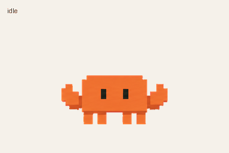
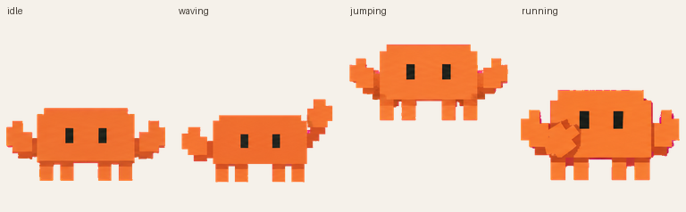
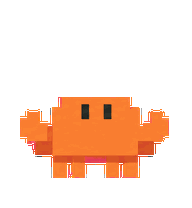

# Clawdy · 你的像素智能拍档

一个 Claude Code 风格的暖橙色像素小伙伴。陪你写代码、等待任务完成，也会眨眼、挥手、跳跃和认真思考。

**九种状态动画 · 十六方向鼠标视线跟随 · 透明精灵图 · 可直接领养与复用**



## 直接 Copy 到你的 ChatGPT

### 方法一：打开领养链接（推荐）

**[点击领养 Clawdy →](https://chatgpt.com/s/sharepet_6acdf49f9adc8191be520acad84372b8)**

1. 打开上面的分享链接，登录你自己的 ChatGPT 账号。
2. 在支持智能拍档 / Pets 的 ChatGPT Work 环境中，按照分享页提示将 Clawdy 加入自己的宠物列表。
3. 在宠物列表中选择 Clawdy，即可将它设为当前拍档；若领养后已经启用，则无需重复选择。

领养会在你的账号中创建自己的副本，不会改变作者正在使用的拍档。此方式依赖你的账号和使用界面支持 Pets；下载 GitHub 项目本身不会自动启用 ChatGPT 功能。

若你正在使用支持 Pets 工具的助手，也可以复制下面这句话发送给它：

```text
请领养这个 ChatGPT 动画宠物，并将它设为当前启用的智能拍档：
https://chatgpt.com/s/sharepet_6acdf49f9adc8191be520acad84372b8
```

### 方法二：下载素材，在自己的项目中使用

点击 GitHub 的 **Code → Download ZIP**，或克隆仓库：

```bash
git clone https://github.com/vinsonnnnn/Clawdy.git
cd Clawdy
```

- [最终透明精灵图 PNG](assets/clawdy-v2.png)：完整的 73 帧，适合导入支持此布局的播放器。
- [机器可读配置 pet.json](pet.json)：每个动作的行号、帧数、播放时间和视线方向。
- [GIF 动画预览](assets/previews/Clawdy.gif) / [MP4 预览](assets/previews/Clawdy.mp4)。
- [独立动作 GIF](assets/previews/)：方便放进介绍页面、文档或聊天中。

需要导入 ChatGPT 时优先使用领养链接。精灵图是图像资源；GitHub ZIP、GIF 和 `pet.json` 不是通用的 ChatGPT 一键安装包。

## 九种动作

Clawdy 既会用动作回应交互，也会用姿态表达工作状态。**眨眼包含在待机动画中，“思考”对应 `running` 状态。**这里的 `running` 表示正在处理任务，左右移动分别使用 `running-right` / `running-left`。

| 动作 | 状态名 | 帧数 | 你会看到什么 |
| --- | --- | ---: | --- |
| 待机与眨眼 | `idle` | 6 | 安静呼吸、轻微起伏、眨眼，陪伴时不过分抢眼 |
| 向右移动 | `running-right` | 8 | 眼睛朝右，小脚交替迈动 |
| 向左移动 | `running-left` | 8 | 与向右移动对应的左向步态 |
| 挥手 | `waving` | 4 | 抬起小爪子打招呼，再放回原位 |
| 跳跃 | `jumping` | 5 | 蓄力、离地、最高点、下降、落地 |
| 遇到问题 | `failed` | 8 | 身体低下、小爪垂落、眼睛变扁，表达受挫 |
| 等待 | `waiting` | 6 | 带着期待轻轻侧身，等待你的输入或确认 |
| 思考与处理 | `running` | 6 | 小爪移到脸旁或身前，专注思考 |
| 检查结果 | `review` | 6 | 眼睛扫视、身体轻微倾斜，像在认真核对输出 |

实际触发哪些动作由宿主应用决定。仓库附带的演示播放器可以手动切换全部九种动作。



## 十六方向鼠标视线跟随

Clawdy 还有一整圈 **16 个张望姿态**，每隔 22.5° 一个方向。以屏幕坐标为准：向上为 0°，顺时针经过右侧 90°、下方 180°、左侧 270°。

眼睛会作为完整的黑色矩形一起移动，身体基本保持正面、脚部固定。鼠标绕着它移动时，播放器根据鼠标相对宠物中心的方向选择对应帧。鼠标落在中心附近时回到待机；演示播放器中的死区半径为 24 个 CSS 像素。



这些方向是手工审核过的离散生成姿态，不是实时 3D 转头；部分接近垂直方向的横向变化较轻微。张望姿态比待机略窄，保持相同角色设计和稳定落脚位置。

## 本地互动预览

直接用浏览器打开 [`demo/index.html`](demo/index.html)，即可切换动作、调整显示大小，并在预览区域移动鼠标体验十六方向视线跟随。该页面不依赖第三方库，也不会发送网络请求。

也可以启动本地静态服务器：

```bash
python -m http.server 8000
```

然后访问 `http://localhost:8000/demo/`。GitHub 文件页面不会直接运行 HTML，需要下载到本地打开或自行部署静态页面。

## 资源与布局

| 参数 | 值 |
| --- | --- |
| 格式 | 带透明通道的 PNG |
| 版本 | v2 精灵图布局 |
| 整张尺寸 | 1536 × 2288 像素 |
| 网格 | 8 列 × 11 行 |
| 单格尺寸 | 192 × 208 像素 |
| 标准动作 | 前 9 行，共 57 帧 |
| 张望姿态 | 最后 2 行，共 16 帧 |
| 总有效帧 | 73 |
| 空白格 | 15 格，完全透明 |

每一行的有效帧从最左边开始。不要把每行都当作八帧播放，否则会播放到透明空白格。

```text
assets/clawdy-v2.png      最终透明精灵图
assets/previews/          九种动作、完整动画和视线循环预览
pet.json                 状态、时序、方向和校验值
demo/index.html          零依赖互动播放器
docs/SPRITE_SPEC.md       布局与集成说明
docs/QUALITY.md           验证结果与已知限制
tools/sprites.py         校验、提取帧与导出 GIF
LICENSE                  MIT 许可
```

完整帧布局见 [动作总览](docs/contact-sheet-final.png)，视线姿态见 [十六方向检查图](docs/direction-qa.png)。

## 提取帧与生成 GIF

使用 Python 3.10+：

```bash
python -m pip install -r requirements.txt
python tools/sprites.py validate
python tools/sprites.py export --output output
```

`validate` 检查尺寸、透明通道、有效格、空白格和 SHA-256。它用于确认资源完整性，不替代宿主应用的导入检查或人工动画审查。

`export` 按 `pet.json` 提取各个动作帧与十六个张望帧，并按原始时序导出循环 GIF。要接入自己的网页、桌面小组件或游戏，只需读取精灵图相应区域；详细公式和时序见 [SPRITE_SPEC.md](docs/SPRITE_SPEC.md)。

## 创作与复用

Clawdy 由生成式图像工具创作，经透明背景处理、逐帧提取、注册对齐、动画预览与方向审查后整理成精灵图。此项目提供最终可用资源与轻量演示/导出代码，不包含底层图像生成服务或 ChatGPT Pets 后端。

欢迎 Fork、下载、修改和用于自己的项目。项目代码及作者可授权的图像素材以 [MIT License](LICENSE) 发布，分发时保留许可声明。Claude、Claude Code、ChatGPT 等名称及其商标权不属于本项目许可范围。

这是受 Claude Code 像素形象启发的独立社区作品，与 Anthropic 或 OpenAI 无官方隶属、赞助或背书关系。

喜欢这个小伙伴的话，可以给仓库一个 Star，也欢迎分享你的改版。
